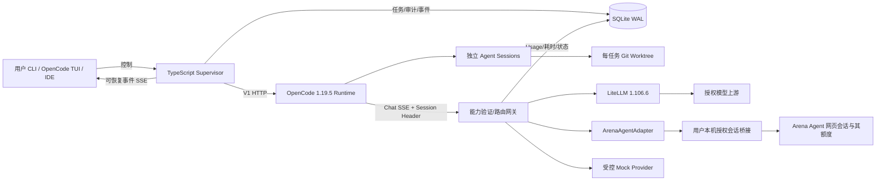

# CoAgent 技术研究与实施方案

核查日期：2026-10-29。本文记录明确决策、证据范围及对应实现；实际运行结果见 `validation.md`。用户最新指令要求在研究后继续开发，因此本仓库包含实现，不只停留在原提示词的方案阶段。

## 1. 执行摘要

主架构选 C：独立 TypeScript Supervisor + OpenCode Runtime + 可替换模型适配器；正式多协议网关采用 LiteLLM。Arena Agent 网页免费额度是首要研究场景，保留独立直连本机桥接服务的 `arena` 模式。它不要求付费推理 API，但需要用户有权使用的 Arena 账号、现有 Agent 会话和本机桥接服务。没有登录会话时只能完成等效协议实验，不能宣称已验证免费额度。

固定 OpenCode **V1 1.19.5**，通过 V1 HTTP API 和一个 V1 `chat.headers` 插件连接。在线 npm 核查 V2 包 `@opencode/cli` 为 **2.2.1**，与 V1 包 `opencode-ai` 不同。V2 服务端契约改变，暂不迁移，绝不将 V1 SDK 的 `/v2` 导出误称为产品 V2。[V1 文档](https://opencode.ai/docs/)；[V2 迁移文档](https://opencode.ai/v2/docs/migrate-v1/)；[V1 发布](https://github.com/anomalyco/opencode/releases/tag/v1.19.5)。这些版本只代表本次核查时间，后续运行不会自动升级。

本机 Chat Completions 实现是能力检查、研究边界和观测层，不替代 LiteLLM 的供应商协议转换。Responses 和 Messages 委托 LiteLLM；没有 LiteLLM 的模式明确返回 501。Arena 模式不开启未验证的其他协议。

## 2. 联网核查报告

证据分级：A=本仓库实际测试；B=固定源码证实；C=官方文档或维护者声明；D=待实测。第三方源码只读，不执行其登录、账号采集或验证相关程序。研究缓存位于 `/tmp/coagent-research`，下面的固定链接是长期可定位的证据。

| 项目 | 固定源码快照 | 最近 push（API 核查） | 许可证 |
|---|---|---|---|
| devin-fusion-byok | `2a1cffb531bf29ae450f5be45e177c48c9663936` | 2026-10-28 | MIT |
| arena2api | `259e27c2a96c8203cfe6d67140490b0db9f91543` | 2026-03-10 | 仓库 API 未识别许可证，不能据此假设可复制分发 |
| LudusProxy | `1a5fc091d03a1206355ed600412046d739208c87` | 2026-06-17 | 仓库 API 未识别许可证 |
| arena-local-bridge | `403122cf575b82aa519cad7c81a4cfe7d224d474` | 2026-10-29 | MIT |

### Devin BYOK

扩展安装于 Devin 的扩展宿主，VSIX 提供设置界面与生命周期。本地 Node 服务负责模型目录与协议桥接；Devin CLI 仍是 Agent 执行端。[README](https://github.com/kuobibulaien/devin-fusion-byok/blob/2a1cffb531bf29ae450f5be45e177c48c9663936/README.md)（C）。

[acp-injection.cjs](https://github.com/kuobibulaien/devin-fusion-byok/blob/2a1cffb531bf29ae450f5be45e177c48c9663936/src/runtime/acp-injection.cjs) 使用 `vscode.windsurfAcp.registerConnection` 并改写 connector 的 authenticate metadata 中的 API 地址；这是具体宿主耦合，不应当成稳定通用扩展标准（B）。[bridge.cjs](https://github.com/kuobibulaien/devin-fusion-byok/blob/2a1cffb531bf29ae450f5be45e177c48c9663936/src/runtime/bridge.cjs) 提供本地 HTTP 桥接，[host-catalog.cjs](https://github.com/kuobibulaien/devin-fusion-byok/blob/2a1cffb531bf29ae450f5be45e177c48c9663936/src/runtime/host-catalog.cjs) 参与原生目录接入（B）。

源码目录分别提供 Chat、Responses、Anthropic 适配；README 描述 Lead/Sidekick 可分别选择模型，模型目录有供应商信息（B/C）。这支持设计上的跨 Provider 配对，不等于本环境已执行 Devin Fusion。持久 Sidekick 对话依赖宿主，扩展的上下文监控及目标存储不能证明完整会话恢复。没有安装 Devin，未验证其可用版本范围；源码测试含 `real-picker-0.3.11` 样本，但不能据此承诺所有 Devin 版本兼容（D）。借鉴能力注册、固定模型选择、目录桥接；不复制宿主内部注入机制。

### Arena 官方资料

已发现 [Arena 官方开发者入口](https://platform.arena.ai/docs/claude-code) 和 [OpenCode 接入页](https://platform.arena.ai/docs/opencode)，要求 API key，并提示模型受账号授权约束（C）。因此“没有官方 API”不成立；**网页 Agent 免费额度与官方 API 授权、额度不是同一承诺**，本项目不会擅自改用付费 API。

已查阅 [服务条款](https://help.arena.ai/articles/5629909088-terms-of-use) 和 [隐私政策](https://help.arena.ai/articles/3765052346-privacy-policy)。网页输入及元数据属于服务处理的数据，不能把本地网关等同于源码不离开设备。部署者应确认账号使用及项目数据适合该服务。本项目不实现验证绕过、账号采集或配额规避。未测量真实额度、吞吐、数据保留期限或企业保障。

## 3. Arena 反代可行性评估

| 核查项 | arena2api | LudusProxy | arena-local-bridge |
|---|---|---|---|
| 实现 | 扩展辅助 + Python HTTP 服务 | 浏览器状态辅助 + TS HTTP 请求 | 浏览器辅助 + Node 本地服务 + 持久 Agent 会话 |
| Chat API | `/v1/chat/completions` | `/api/v1/chat/completions` | `/v1/chat/completions` |
| SSE | 服务端流式格式转换 | Chat 路由接受 stream 字段但所读实现直接返回 JSON | 有流式及工具回合缓冲输出 |
| Messages | Chat 路由包含 Claude 格式分支；未证实独立完整 Messages API | 有独立 messages 路由 | 所读 server 路由未见 Messages 端点 |
| 上下文 | 把历史拼成文本，非逐条原生角色语义 | Chat 只取最后一条 user 消息 | 持久会话绑定，并格式化历史/工具结果 |
| 外部工具 | 所读 server 未发现完整 tools/tool_calls 实现 | Chat 类型和实现无 tools 处理 | `format.mjs` 要求打印 `<tool>` JSON，属于文本模拟 |
| 取消与并发 | 无本仓库端到端证据 | 无本仓库端到端证据 | 有队列、busy、会话池代码；不等于取消已传播到网页上游 |
| 接入证明 | README 声明不等于独立测试 | 同左 | README 针对编码客户端说明，不等于本环境实测 |

依据：[arena2api server.py](https://github.com/flay-o/arena2api/blob/259e27c2a96c8203cfe6d67140490b0db9f91543/server.py)；[LudusProxy chat.ts](https://github.com/gr0xy/LudusProxy/blob/1a5fc091d03a1206355ed600412046d739208c87/src/routes/chat.ts)；[messages.ts](https://github.com/gr0xy/LudusProxy/blob/1a5fc091d03a1206355ed600412046d739208c87/src/routes/messages.ts)；[bridge format.mjs](https://github.com/Gandhara2077/arena-local-bridge/blob/403122cf575b82aa519cad7c81a4cfe7d224d474/src/format.mjs)；[bridge server.mjs](https://github.com/Gandhara2077/arena-local-bridge/blob/403122cf575b82aa519cad7c81a4cfe7d224d474/src/server.mjs)。以上为 B，不是实时服务验证。

结论：网页会话到标准聊天协议的转换成立；完整 Coding Provider 要求工具调用 ID、参数、结果匹配、多轮角色、取消、上下文上限及权限均正确。文本模型可以尝试编码工具协议，但不具备原生语义保障。本实现默认拒绝模拟工具；Arena Agent 模式须显式开启，仍做工具白名单、JSON Schema、结果 ID、独立会话及运行时权限检查。Schema 正确不代表命令安全或模型正确，执行权限仍由 OpenCode 决定。

不进行“高吞吐免费服务”压测。先单请求、单 Worker 验证，429 即停止当前尝试，不自动账号轮换。免费额度由实际账号和服务规则决定，不能推导无限免费。

## 4. OpenCode 与 Devin 技术比较

OpenCode V1 提供 CLI/TUI、HTTP Server、生成 SDK、Agent/Subagent、Provider、Plugin、Session、MCP、ACP、IDE/Web 界面。任务执行与工具循环直接复用 Runtime；持久任务 DAG、调度审计和跨 Worktree 验收由 Supervisor 管理。[Server](https://opencode.ai/docs/server/)；[Agents](https://opencode.ai/docs/agents/)；[Plugins](https://opencode.ai/docs/plugins/)；[SDK](https://opencode.ai/docs/sdk/)；[ACP](https://opencode.ai/docs/acp/)。

`#20725` 的作者后续用数据库记录指出插件实际发送了默认 OpenAI 模型，并将根因定位于 oh-my-opencode 3.14.0 的路由。不能把最初猜测当作 OpenCode 核心缺陷。[讨论](https://github.com/anomalyco/opencode/issues/20725)。`#39303` 无版本信息，60 天不活跃后自动关闭，无修复提交证据，不能说已修好。[讨论](https://github.com/anomalyco/opencode/issues/39303)。

固定 [V1 task.ts](https://github.com/anomalyco/opencode/blob/v1.19.5/packages/opencode/src/tool/task.ts) 可见子 Agent 优先使用自身 model，随后显式向 prompt 传入 providerID/modelID（B）。本仓库在没有 OPENAI_API_KEY 的隔离测试环境中验证自定义 Provider 子会话实际请求目标模型（A，见测试报告）；仅证明本仓库这一配置路径，不覆盖 Issue 的所有环境。

Devin BYOK 可保留原生 Fusion UX，但内部宿主兼容成本更高；OpenCode 更便于检查 API、隔离工作目录并进行无账号的协议测试。两者都不是“接一个 chat API 就保证能编码”。

## 5. 最终技术架构选择

评分为本项目工程判断（1 差—5 好）；“开发容易/维护容易”越高越有利，不是测量结果。

| 维度 | A Devin BYOK | B OpenCode 插件 | C 独立 Supervisor | D 自研 Runtime |
|---|---:|---:|---:|---:|
| 功能完整度 | 4 | 4 | 5 | 2 |
| 开发容易 | 4 | 4 | 3 | 1 |
| 维护容易 | 2 | 3 | 4 | 1 |
| 模型/插件兼容 | 3 | 4 | 4 | 3 |
| 多 Agent | 4 | 4 | 5 | 3 |
| 长任务 | 3 | 3 | 5 | 2 |
| 上下文复用 | 4 | 4 | 4 | 2 |
| 多模型路由 | 4 | 4 | 5 | 4 |
| 本地效率 | 3 | 4 | 4 | 3 |
| IDE 体验 | 5 | 4 | 4 | 1 |
| 可观测性 | 3 | 3 | 5 | 3 |
| 企业扩展 | 2 | 3 | 4 | 3 |

选择 C。A 的内部扩展接口及账号依赖难以稳定维护；B 把后台任务生命期绑在插件进程里；D 重复实现工具沙箱、编辑器、上下文及 Agent 循环。C 复用 Runtime，独立持久化任务，并通过单一适配层更换上游。

## 6. 模型网关与 Provider Adapter

接口以 `src/types.ts` 为准：`ModelAdapter.generate(request, signal)` 输出 text/tool/usage/finish 事件。`ModelCapabilities` 声明 streaming、工具语义、并行工具、上下文、输出及协议；未验证能力不伪装为支持。

- OpenAIAdapter：标准 Chat SSE 上游，保留消息、工具和请求参数；不解析或执行自然语言命令。
- ArenaResearchAdapter：只读文本研究通道，禁止编码工具。
- ArenaAgentAdapter：已授权本机桥接端点；session header → 显式绑定文件 → 已存在的 Arena Agent UUID。实际 UUID 路径忽略上游请求的工具字段，所以本适配器将消息和工具 Schema 显式编码进文本，并解析带本轮标识的工具帧，随后继续进行 Schema 校验。最终答复帧按相同标识解封，Reviewer 的 JSON 不混入前导说明。禁止同一 Arena session 分配给两个 Agent；不自动创建或采集会话。
- MockAdapter：确定性协议测试；usage 标为估计值，不代表模型效果。
- LiteLLM：处理供应商及 Responses/Messages 协议转换，版本锁定 1.106.6。

SSE 使用增量 TextDecoder，支持拆包 UTF-8、CRLF、多行 data、心跳；要求明确结束事件，断流不补造成功。工具片段按 index 聚合，完整 JSON Schema 验证后返回，禁止未知工具、重复 ID、孤立结果。失败流发送 error，省略 `[DONE]`，让客户端识别失败。

并发信号量有有限队列；超时覆盖排队、连接、读取；取消释放槽位。Node fetch 复用其连接池。常规模式有限指数退避并尊重 Retry-After；仅在尚未输出内容时重试或 fallback；输出后不重放。熔断按 adapter/model 计数。Arena 模式串行、零重试、无 fallback，额度错误交还用户。2026-10-30 的真实 Runtime 测试确认 OpenCode 还会重试 HTTP 409，因此 Arena 模型入口将需人工处理的错误转为本地 422，避免 Runtime 再次访问网页上游；绑定控制面仍可使用 409 表示冲突。依据：[固定版重试策略](https://github.com/anomalyco/opencode/blob/v1.19.5/packages/opencode/src/session/retry.ts)。

上下文采用 UTF-8 字节保守上限，包含工具定义；不伪装精确 tokenizer，也不静默截断历史。上游 usage 是统计依据，缺失值保持未知。价格未知记 null，不能按 0 宣称免费。模型别名固定 lead/sidekick/reviewer；LiteLLM 供应商模型通过环境变量配置。

仅绑定 loopback，Bearer key 保护控制面和模型面，OpenCode 使用独立 Basic Auth。日志默认不记录 Authorization、请求体或上游错误正文；任务内容及会话仍是本地敏感数据，需要用户自己的文件权限与备份策略。

## 7. 多 Agent 调度与持久上下文

默认 1 Lead + 1 Sidekick + 按需 Reviewer。Explorer 是只读角色，按需启动，无常驻额外模型。Lead 通过 `/plan` 输出小 DAG，计划必须先通过结构和依赖校验，创建后等待批准；不会直接执行模型输出的 shell。

任务状态：queued → awaiting_approval → running → reviewing → succeeded。错误进入 failed；依赖失败进入 blocked；显式 pause/cancel 中断执行。恢复不会把中断中的工具调用当作幂等操作重放：数据库启动时将 running/reviewing 转成 paused，用户检查 Worktree 后显式 resume。

每个工作目录和角色对应一个持久 OpenCode Session；重试复用 Worker Session，Reviewer 使用独立 Session。OpenCode 保存完整历史，Supervisor 仅保存 session ID、最新报告及角色模型。Worker 完成后保存待审查检查点；Reviewer 传输或格式失败后显式恢复只重做审查，审查拒绝或外部验收失败后才重新执行 Worker。模型切换显式传 model，不重新创建 Session。跨 Agent 传递依赖任务报告和 Worktree 路径，不共享聊天内存。Prompt 缓存是上游能力，不保证命中；上下文压缩使用 Runtime summarize 合约，不自造隐式截断。

DAG 优先级高者先运行，依赖必须成功才可领取。单 Supervisor 通过 SQLite lease 防止两个进程重复调度；长任务不持有数据库事务。可配置 1–8 并发；Arena 强制 1。在每个 Worker 的独立 Worktree 中编辑和验收，不与 Lead 或其他 Worker 共享可写目录。

依赖报告不意味着依赖代码已自动合并。各任务应拆成独立变更，依赖代码必须先经人工审查整合。当前系统保留分支和脏工作树，不自动提交、推送、强制清理或冲突回滚。这样失败代码可检查。生产团队可在外层加入受审批的合并队列，不应将尚未实现的自动合并描述为已有功能。

1+1 适于串行依赖重的任务；1+2/1+3 只对可分离代码区域有潜在收益。需要真实任务集测量协调成本、冲突和返工，不把 Mock 时延当作模型性能证据。

## 8. 完整系统架构图



控制流在 Supervisor 与 Runtime；模型数据经网关到上游；文件操作仍由 Runtime 工具实施。Arena 线路不需要 LiteLLM，避免文本模拟再多次协议转换。正式多供应商路径保留 LiteLLM。

## 9. 技术栈、配置与目录

Node 24（实测 24.21.0），TypeScript 5.9.3，npm lock；不同时引入 Bun 应用运行时。OpenCode 内部使用其自身打包运行时，不强制重建。SQLite 使用 Node 内置 `node:sqlite`，无需 Redis/Postgres。LiteLLM 独立 Python venv（Python 3.13.5 实测安装环境，最低按其官方包要求）。不加入 Docker、Langfuse、React 或自研 IDE：本地 CLI 与 OpenCode 原生 UI 足以承载首版，外部观测可以后续接入。

```
config/             OpenCode V1、LiteLLM 配置
src/types.ts        核心合约
src/gateway/        Adapter、SSE、Schema、并发与路由
src/runtime/        OpenCode V1 HTTP、session header 插件
src/supervisor/     SQL、Store、DAG、Worktree
src/server.ts       鉴权后的模型和任务 API
src/cli.ts          本地服务与命令入口
tests/              协议、任务、故障、Arena 模拟桥接测试
tests/integration/  真实 OpenCode/LiteLLM 进程测试
docs/               研究、验收、使用说明
```

具体配置位于 `config/opencode.json`、`config/litellm.yaml`、`.env.example`。启动 Runtime 时以模板生成 `.coagent/runtime/opencode.json`，同步网关端口和 Arena 的输出/上下文限制，插件路径转为明确文件 URL，保持源模板不变。敏感信息只用环境变量，不进入配置正文。OpenCode Provider 仅启用 coagent，减少静默切换到其他供应商的风险。V1 的 singular `provider/agent/permission` 与 V2 的 plural 形式不混用。

## 10. 核心 API、类型与数据库

所有指定类型已经定义：ModelAdapter、ModelCapabilities、AgentRole、AgentSession、Task、TaskStatus、TaskDependency、TaskExecution、ToolCall、ModelUsage、WorktreeManager、AgentOrchestrator。以可编译的 `src/types.ts` 为合约，避免文档与实现重复漂移。

| API | 用途 |
|---|---|
| GET /health | 最小存活状态，不代表上游就绪 |
| GET /v1/models | 模型别名和能力 |
| POST /v1/chat/completions | 普通/流式聊天与工具调用 |
| POST /v1/responses, /v1/messages | 配置 LiteLLM 时转交，否则 501 |
| POST /plan/prepare | 创建或复用 Lead Session，供显式 Arena 会话绑定 |
| POST /plan | Lead 分解计划并建立待审批 DAG |
| POST /tasks | 原子提交 1–100 个任务，验证依赖 |
| GET /tasks, /tasks/:id | 状态、报告、工作目录 |
| POST /tasks/:id/prepare | 建立工作目录及 Worker/Reviewer Session，等待批准 |
| POST /tasks/:id/approve,pause,resume,cancel | 显式控制状态 |
| GET /sessions | 获取 Runtime session ID，用于 Arena 显式绑定 |
| POST /arena/bindings | 绑定已准备的 OpenCode Session 和已有 Arena UUID，拒绝重复绑定 |
| GET /events | 带递增 ID 的 SSE；Last-Event-ID/after 恢复游标 |
| GET /metrics | 请求、Token、已知费用、未知费用计数 |

完整 SQL 是 `src/supervisor/schema.sql`：tasks、dependencies、sessions、executions、events、worktrees、model_requests、audit_log、scheduler_lock。任务状态与事件在事务中更新；唯一约束阻止同一角色/工作目录重复 Session；依赖图插入前进行环检测；SQLite WAL 支持读取并发。它是本机单调度器设计，不宣称分布式 exactly-once。

## 11. 最小可运行原型

`npm start` 启动受鉴权本地控制/模型服务；`npm run coagent -- runtime` 启动固定版本 OpenCode；`submit` → `prepare` → `approve` → `events` 为任务路径。所有调用都使用真实 V1 HTTP 合约，不虚构 SDK 方法。

无需账号的自动测试使用受控 Provider 发出真实结构化工具调用，OpenCode 执行工具，测试检查文件及会话历史。普通 MockAdapter 只做协议演示，不能把它输出的 mock 文本当作可工作的编码模型。

Arena 接入流程见 `arena.md`。首次使用需完成实际登录并准备已有会话，在线验收记录以 `validation.md` 为准。`prepare` 可先创建对应 OpenCode Session，用户为其绑定各自授权的 Arena Agent Session，再执行任务。

## 12. 自动化测试与验收方案

| 层次 | 环境/输入 | 预期与通过标准 |
|---|---|---|
| 协议 | Node 24，本地 HTTP，中文拆包、tools、tool result | 字符不损坏；参数严格匹配；孤立结果拒绝 |
| OpenCode | 固定二进制、隔离 XDG、无 OPENAI_API_KEY | 工具实际写文件；子 Agent 请求到指定 alias；历史重启保留 |
| Multi-Agent | 临时真实 Git repo、多个独立工作树 | 无同文件覆盖；依赖按序；Reviewer 拒绝使任务失败 |
| 故障 | 注入 429/503、断流、超时、取消、DB 重开 | 有界重试；输出后不重试；中断恢复为 paused；无误报成功 |
| Arena 等效 | 本地桥接 Fixture，固定 UUID 映射 | 未绑定拒绝；共享会话拒绝；配额错误不重试；模拟工具显式启用 |
| 真实 Arena | 用户授权会话、小任务一次工具往返 | 需要网页登录后另测；记录真实额度、延迟和取消效果 |
| 长稳/性能 | 固定真实代码任务集，单强/1+1/1+2/1+3 | 同一提交与验收测试，至少多次重复；统计成功率、返工、Token、费用、P95 |

测试覆盖范围及失败修复记录由 `validation.md` 给出。测试通过不能外推为长时间稳定、复杂任务模型质量或企业 SLA。

## 13. 稳定性与权限设计

任务审批只批准具体任务及其验收 argv；不会把模型自然语言拼进 shell。高风险 bash 由 OpenCode 交互审批，Reviewer/Explorer 禁止 bash 与编辑，外部目录拒绝。工作树不是系统沙箱：不可信仓库或工具应另放容器/VM，这属于部署隔离边界。

SQLite lease 防止重复 Supervisor，崩溃后任务暂停供检查。重启后复用 Session 前会停止仍标记运行中的旧会话。会话 abort 不可达或未确认时保留 running 会话标志，任务保持 paused，之后复用前重新确认停止。已提交 Runtime 的回合可能执行过工具，即使最终返回暂时错误也不自动重放。日志中不输出供应商错误正文和密钥；任务报告与本地 SQLite 不是公开日志。

网关对异常 JSON、未知模型、孤立工具结果、缺失 SSE 结束、队列过载、无效配置分别报错。服务 shutdown 先暂停活动任务，再关闭连接。Worktree 清理拒绝脏目录和越界路径；不会用强制删除掩盖失败。

## 14. 分阶段任务清单

| 阶段 | 目标/依赖 | 文件与接口 | 自动化测试与交付 | 验收/剩余风险 |
|---|---|---|---|---|
| P0 | 核查来源/固定版本 | 本文、package lock、ModelCapabilities | 官方文档及固定源码记录 | Arena 小任务已实测；其他第三方集成未测 |
| P1 | 协议/能力网关 | gateway/*、ModelAdapter | Chat/SSE/tool/error/cancel 测试 | 文本模拟不变为原生 |
| P2 | 单 Agent Runtime | runtime/*、V1 config | 实际工具执行/重启/模型切换 | 只覆盖锁定版本 |
| P3 | 持久 Sidekick/Reviewer | sessions、Orchestrator | 重试复用/独立审查及 Arena 在线小任务 | 复杂任务质量未验证 |
| P4 | DAG/Worktree | Store、GitWorktrees | 环拒绝/隔离/审批/依赖 | 无自动合并队列 |
| P5 | 并发与验收 | acceptance argv、任务控制 | 多 Worker 同文件隔离/拒绝审查 | 并发收益不作推断 |
| P6 | 恢复与观测 | lease、events、metrics | DB 重启/超时/取消 | 未完成多日 soak |
| P7 | 本地交互 | CLI、OpenCode 原生界面 | API 与 CLI 路径 | 独立 Web DAG 前端未实现，原生界面复用 |

开发以每阶段可运行结果推进，不等待所有模块才集成。上述清单同时说明当前交付边界，未实现项不会标为完成。

## 15. 未解决问题和验证顺序

已完成：用户授权的本机 Arena 桥接与两条独立现有会话，经真实 OpenCode 工具完成本地 read/edit/read、独立 Reviewer 审查及 Supervisor 外部验收；详见 `validation.md`。这证明一个小型修复任务的完整链路，不代表复杂任务可靠性。

优先级 2：确认浏览器侧取消是否真的停止执行；验证上下文累积、模型身份、实际 Token 统计与配额耗尽响应。无法确认时保持串行，禁止自动重放。

优先级 3：多日稳定性、故障后恢复、同仓库依赖代码整合；完整真实模型固定任务集对比。没有数据前不推荐增大 Worker 数。

优先级 4：若迁移 V2，先单独实现其新版 Server 客户端与插件，再运行同样契约测试，不能只改版本号。

### 五个明确回答

**Q1**：不能把所查 Arena 项目直接统称为完整 Coding Provider。Chat 包装存在源码证据，工具/多轮/取消各有缺口；arena-local-bridge 的 UUID 路径需要额外封装工具上下文。CoAgent 已在用户授权的 Arena 在线会话中，以文本模拟工具协议完成一个真实本地修复任务、独立审查和测试；复杂编程质量、远端取消及额度边界仍待验证。

**Q2**：V2 是真实存在的新产品版本，但对本轮最快交付而言，V1 1.19.5 的已核验 HTTP 契约更合适。两个 Issue 不构成 V2 的决定性缺陷证据；本方案不声称 V2 不可用。

**Q3**：Lead + 1 持久 Sidekick + 按需独立 Reviewer。工具执行/会话/编辑/TUI 复用 OpenCode，DAG、工作树、审批、状态恢复及模型能力边界由独立 Supervisor 提供。

**Q4**：统一内部事件合约，能力先检验，SSE 和 tool 参数严格校验，LiteLLM 提供正式协议转换；独立 Session/Worktree、有限并发、持久状态、明确取消与恢复。Arena 工具模拟须显式授权，不能伪装为原生能力。

**Q5**：先 types/protocol/adapters + 协议测试，再 Runtime + 实际工具执行，再 Store/orchestrator/worktree + 完整链路测试。本仓库已按此结构实施，并已完成用户授权 Arena 会话的小任务在线验收；下一步验证范围见本节优先级列表。
